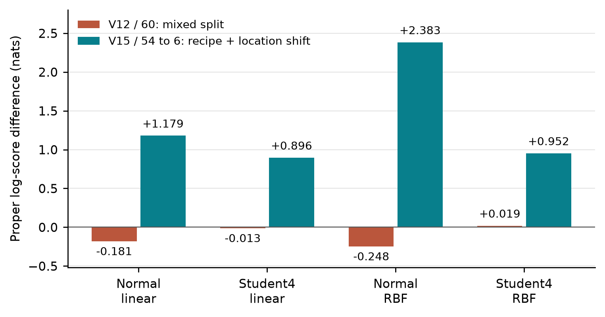

> **Current opening section:** [Introduction and study rationale](introduction/README.md) · [3-page A4 PDF](introduction/study-introduction-en-a4.pdf), aligned with V48 of the ongoing manuscript. The six-page evidence review below is retained as its historical companion.

# Initial Research Report and Evidence Review

[English A4 PDF](initial-research-report-en-a4.pdf) · [Editable Google Doc (owner access)](https://docs.google.com/document/d/1YQ0nykHUVAjsuiW9YJCuJalLc7dS3Rg69qCMtrIjVJc/edit?usp=drivesdk) · [Turkish companion](../README.md)

## From Open Data to Microstructure: Initial Research Report

Research Record 1 · Evidence Review · 25 October 2026 · Version 0.1 (English)

## Abstract

We began by asking whether a few fatigue tests from a new production condition could support a useful and reliable life decision for additively manufactured stainless steel. Because the complete data behind the motivating study were unavailable, we built our own comparisons using an open database, source audits, and strong baseline models. Revealing three tests improved predictive distribution scores, but the joint requirements for a longer life bound, limited risk, and lower experimental cost were not met. A subsequent XCT analysis found positive score gains when predicting a particular six-specimen group. A mapping control showed that these gains did not require the correct individual specimen-to-feature assignment. This retrospective report records the initial question, actual data, completed calculations, and the reasons for turning to measured grain and cell structure. An independent fatigue-prediction benefit from microstructure has not yet been demonstrated.

Keywords: additive manufacturing; 316L; 316H; fatigue; censored data; XCT; grain orientation; cellular structure.

## 1. The starting question and the change in priority

Our starting point was the probabilistic fatigue-prediction study of AM316L by Centola and colleagues [1]. Fatigue life can scatter even at the same nominal load, so a single life estimate is insufficient: uncertainty and premature-failure risk also matter. We initially asked whether a small number of tests from a new condition could improve a useful lower life bound.

We did not obtain the original 518-row dataset or model code. We therefore do not claim an exact reproduction of that study. Instead, we used FatigueData-AM2022 and additional source-traceable records to examine related baseline models, test-selection rules, and our own prespecified comparisons [2, 3].

The results showed that a better predictive score and a reliable engineering life decision are distinct outcomes. This changed the scientific priority. Our main question is now which measured initial microstructure can add information about fatigue behavior beyond the production, loading, surface, and defect information already available. Fewer tests and computational savings are secondary to this physical question.

## 2. What data did we use?

The number of rows, the number of independent specimens, and the number of independent builds are different quantities. We kept the working inputs, evaluation queries, and physically linked specimen panels separate. Table 1 summarizes the main data groups. The small input tables, column dictionary, and source/hash records are included in the repository [9].

| Data group | Record / physical scope | Use and principal limitation |
| --- | --- | --- |
| 316L working catalogue | 441 observations | Compiled model input; not every row has a verified physical coupon identity. |
| Matched outer evaluation | 396 queries / 37 conditions / 12 source families | Methods see the same observations and supports; no independent-build guarantee. |
| ORNL SS316H | 60 specimens / one build / Lot 4 | 56 failures, 4 right-censored stops; separate from the 316L panel. |

Table 1. Data scope used in this report. A source family is a statistical holdout unit; it does not establish an independent physical build or factory.

The 316L working catalogue contains 441 compiled observations. The matched V6/V7/V8r evaluations use the same 396 query observations across 37 statistical conditions and 12 source families. These counts do not imply that every row has a verified physical coupon identifier or that 12 independent builds were tested. Metadata distinguish database-reported values from unknown or default-ambiguous fields [3, 4]. These are curated working inputs, including documented source-supported corrections and source-family assignments, rather than an unchanged copy of the raw database.

The separate ORNL panel contains 60 SS316H fatigue specimens from AOP24 FP07 / Lot 4: 56 failures and four right-censored stops [5, 6]. The P-specimen identifier and the region ordinal inside the HDF file are distinct fields. We did not combine this 316H panel with the 316L literature compilation as an independent validation panel. Many regions within one build do not create many independent builds.

## 3. How did we compare the calculations?

Rather than relying on random row splits, we evaluated models with an entire source family held out. Preprocessing, feature encoding, and hyperparameter selection used the training side. Matched comparisons gave methods the same queries, revealed support tests, and cycle costs. This helped separate a model change from a change to an easier or different test set [3, 4]. All comparisons retrospectively reused existing fatigue observations; no new physical fatigue tests were performed. A support observation is a revealed test used to update a prediction, whereas query observations remain reserved for evaluation.

For a specimen that survives until testing stops, its true failure time is unknown. We retained event=0 records as right-censored observations rather than teaching the model that they failed at the stopping cycle. For example, the four ORNL stops at 10,005,000 cycles are not observed failures at that cycle. Censoring must be preserved in both learning and life/risk interpretation.

We did not reduce success to one metric. Proper log score for the predictive distribution, the proposed lower life bound, premature-failure risk, finite prediction coverage, and test-cycle cost were evaluated separately. A higher score means a better probability prediction; it does not automatically mean a safer or longer usable life. Source-bootstrap intervals do not establish physical build independence or R90C90 design assurance.

## 4. What did the baselines and new-model trials show?

In the completed V6 audit, the lower confidence bound on the score gain from three revealed tests was positive in all 28 comparisons formed by seven models and four test-selection approaches. This held at both the one-million- and ten-million-cycle analysis horizons. However, none of the 476 evaluated comparison cells at either horizon jointly satisfied the requirements for a longer lower life bound, limited risk increase, sufficient finite coverage, and lower cycle cost [3]. These are calculations on the same data, not 28 or 476 independent physical experiments.

We then added the available surface, heat-treatment, and build-direction metadata and tested a new PyTorch neural candidate. The expected robust contribution was unsupported in V7's 40 prespecified evaluation cells and V8r's 12 matched-input evaluation cells [4]. This does not establish that all neural networks fail or that physical variables are unimportant. It means the declared requirements were not jointly met by the tested inputs, architectures, and settings. Those earlier inputs did not include the specimen-linked XCT information extracted later.

The lesson was that further tuning alone cannot supply missing physical information. Instead of filling unmeasured porosity, residual stress, or thermal fields with invented values, we asked which actual measurement could carry additional information.

## 5. Under what conditions did XCT information help?

The first ParaView pilot extracted descriptive pore features from three volumes. Because adequate links from those volumes to their own fatigue specimens were not established, we did not treat the extraction as evidence of improved life prediction. The later ORNL panel allowed us to test inner and outer record summaries linked to the same physical specimens [5, 6].

V12/V15 summarized positive support in the source's uint16 flaw field. Its complete physical code dictionary remained unresolved, so we did not call these summaries pore volume, diameter, or severity. The transformation from the scan to the actual machined gauge surface was also incomplete. We therefore did not claim to have measured the critical defect of the final specimen directly.

In V12, adding outer-region information did not provide general benefit in mixed specimen splits within the same build: seven of eight score cells were negative, and the small positive cell remained below the fixed +0.02-nat threshold. In V15, training on the nominal recipe and predicting the same six specimens combining high VED and a left-side location produced gains above that threshold for all eight cells formed by four models and two training panels [6]. Figure 1 shows V12/60 and V15/54-to-6.

Figure 1. Proper log-score difference between the outer-record arm and the coverage-control arm. Units are nats; positive is better. V12/60 uses mixed splits; V15/54-to-6 is a combined recipe-and-location shift. Plot labels are rounded to three decimals. The full 16-cell table and full-precision values are preserved in the source CSV [6].

The positive result is limited to a particular task and one build. It does not isolate a recipe effect or establish generalization to an independent campaign. Moreover, after adding outer records, q10 still exceeded observed failure life for three to six of the six failures, depending on the model. Here q10 is the model's 10th life percentile; the observed risk in this six-specimen set is not thereby 10%. The score improvement therefore did not establish a safe design life.

## 6. Why did we not call the positive score an individual microstructure contribution?

The post-result V16 diagnosis found that most of the median-life error reduction was concentrated in correcting the common mean error within each stress group. None of the eight model/training combinations improved within-load pairwise ranking agreement [7]. This was a descriptive error diagnosis selected after observing results, not a causal decomposition of proper log score.

V17 tested a more discriminating control. Within two same-load triplets, we reassigned the three outer features together between specimens while preserving training data and the previous settings. All 36 assignments passed the earlier score threshold across four models and two training panels. This included assignments in which no specimen received its own outer record. Even the worst assignment retained at least 99.35% of the score gain obtained with the correct assignment [8]. This percentage is not accuracy or life improvement.

We thus answered a narrow computational question: for these six queries and this score acceptance criterion, the correct individual assignment was unnecessary. A plausible competing explanation is that the features correct a common production/location shift more than they distinguish individual specimens. We have not established that this is the only explanation. A synthetic donor record may be physically incompatible with the recipient's other features; we did not calculate a causal effect or a p-value. The earlier negative pore result remains preserved and does not imply that pores are generally unimportant.

## 7. Why consider grain orientation and cell structure?

This control led to a sharper physical question: under similar initial grain orientation and loading, does directly measured initial cell-wall organization add information about where cyclic slip or localization develops? Grain orientation and cellular structure are different length scales. A generic crystallization percentage cannot replace them [10].

Initial EBSD orientation is a candidate description of slip geometry relative to the actual loading axis. A nominal Schmid factor is not the local stress, neighboring-grain effect, or slip resistance. Visible wall spacing or wall-intersection density in direct cell images is a separate candidate. These are resolution-dependent two-dimensional measurements, not automatic measures of wall resistance, three-dimensional obstacle spacing, or dislocation density. KAM/GOS/GND cannot substitute for direct cell measurements without justification.

Cui's study provides conditions with similar mean grain size but different cellular appearance and dislocation-related measurements [11]. This supports the concern that mean grain size alone may be insufficient. Heat treatment changes several microstructural components together, however, so the causal effect of cell geometry alone is not isolated.

Lyu T4-2 includes initial and final observations of the same fields [12]. Figure 10c-d and 10f-g are two regions within one specimen, not two independent campaigns. Counting requires distinguishing a physical slip-trace endpoint from an image edge, contrast loss, or an annotation endpoint. The V45 decision records that this measurability gate has not yet been passed [13]. We do not count micropillar compression as fatigue validation or four characterization fields as four fatigue specimens.

## 8. Data and code availability

Readers should be able to inspect the actual small inputs. The project repository includes the 441-observation model input, provenance-marked metadata, ORNL 60/54 numerical inputs, and small results tables, with a catalogue and SHA256 records [9]. Large raw XCT and original source files are identified through versioned source links. Online availability does not settle redistribution conditions. We do not extend the original FatigueData-AM2022 manifest's CC BY 4.0 record automatically to every additional mixed source.

The repository separates analysis code, prespecified protocols, working data, aggregate outputs, and interpretation. Canonical results and negative findings are retained, while a file-level decision record identifies verified duplicate outputs [14]. This organization supports traceability and prevents a successful score from being detached from the controls and limitations needed to interpret it.

This report reviews saved analyses; it does not introduce new model training, simulations, or physical fatigue tests. A claim-evidence index links the scientific statements to their tables and stated scope. Source-specific provenance and reuse conditions remain relevant to each third-party dataset, irrespective of whether a repository is publicly accessible.

## 9. Evidence assessment and the next question

The completed analyses resolve limited methodological questions: learning from a few tests differs from establishing a safe life decision, and a particular XCT score gain did not require the correct individual mapping. Discriminating evidence for the additional fatigue-prediction contribution of initial grain and cell measurements is still missing. This is the present evidence balance, rather than a completed validation of a new microstructure-based fatigue model.

When initial orientation G and direct cell measurement C are available on the same specimens, the next comparison could evaluate B, B+G, B+C, and B+G+C on identical training-test splits. B must include the genuinely known loading, production, surface, and defect context, not only laser settings. Measurement adequacy, uncertainty, and success/failure criteria must be set before seeing the comparison results. This report does not launch that experiment.

Re-expressing a production recipe and adding specimen-specific information are competing explanations. A narrowly scoped same-field image pair may support a local relationship question; an independent life-prediction claim requires specimens with linked initial measurements and their own fatigue outcomes, together with suitable group holdouts. Missing defect measurements do not always prevent a narrower predictive association from being studied, but they limit claims of information beyond defects or causal effect. A positive contribution is not guaranteed.

## References and computational evidence

[[1] Centola et al. Probabilistic fatigue prediction for AM SS316L; motivating paper.](https://doi.org/10.1016/j.engfailanal.2024.109081)

[[2] Zhang and Xu. FatigueData-AM2022, version 2; open data record.](https://doi.org/10.6084/m9.figshare.22337629.v2)

[[3] V6 completed audit of baseline models and decision gates.](https://github.com/denizybd/fatigue-ai-research/blob/main/literature/v6_methods/final_panel_audit_v1/report_tr_v1.md)

[[4] V7/V8r scientific audit of completed results.](https://github.com/denizybd/fatigue-ai-research/blob/main/literature/v7_completed_readonly_science_audit_v1/rapor_tr_v1.txt)

[[5] ORNL SS316H fatigue and XCT data record.](https://doi.org/10.13139/ORNLNCCS/2524534)

[[6] V12/V15 results report and complete score table.](https://github.com/denizybd/fatigue-ai-research/blob/main/literature/outer_region_signal_feasibility_v12/sonuc_ve_karar_tr_v1.txt)

[[7] V16 decomposition of error reduction.](https://github.com/denizybd/fatigue-ai-research/blob/main/literature/shift_gain_decomposition_v16/yorum_tr_v1.txt)

[[8] V17 specimen-assignment control.](https://github.com/denizybd/fatigue-ai-research/blob/main/literature/within_load_mapping_control_v17/kisa_karar_tr_v1.txt)

[[9] Actual small inputs, data catalogue, and column dictionary.](https://github.com/denizybd/fatigue-ai-research/blob/main/data/README.md)

[[10] V44 rationale for the physical question and candidate measurements.](https://github.com/denizybd/fatigue-ai-research/blob/main/literature/microstructure_question_feasibility_v44/karar_notu_tr_v1.txt)

[[11] Cui et al. Primary study examined for the grain/cell distinction.](https://doi.org/10.1016/j.jmst.2021.10.006)

[[12] Lyu et al. Study containing initial/final same-field observations.](https://doi.org/10.1016/j.msea.2024.147652)

[[13] V45 cell-wall/slip-trace measurability decision.](https://github.com/denizybd/fatigue-ai-research/blob/main/literature/physical_microstructure_route_gate_v45/sonuc_tr_v1.txt)

[[14] File inventory and exact-duplicate decision record.](https://github.com/denizybd/fatigue-ai-research/blob/main/docs/inventory/README.md)
